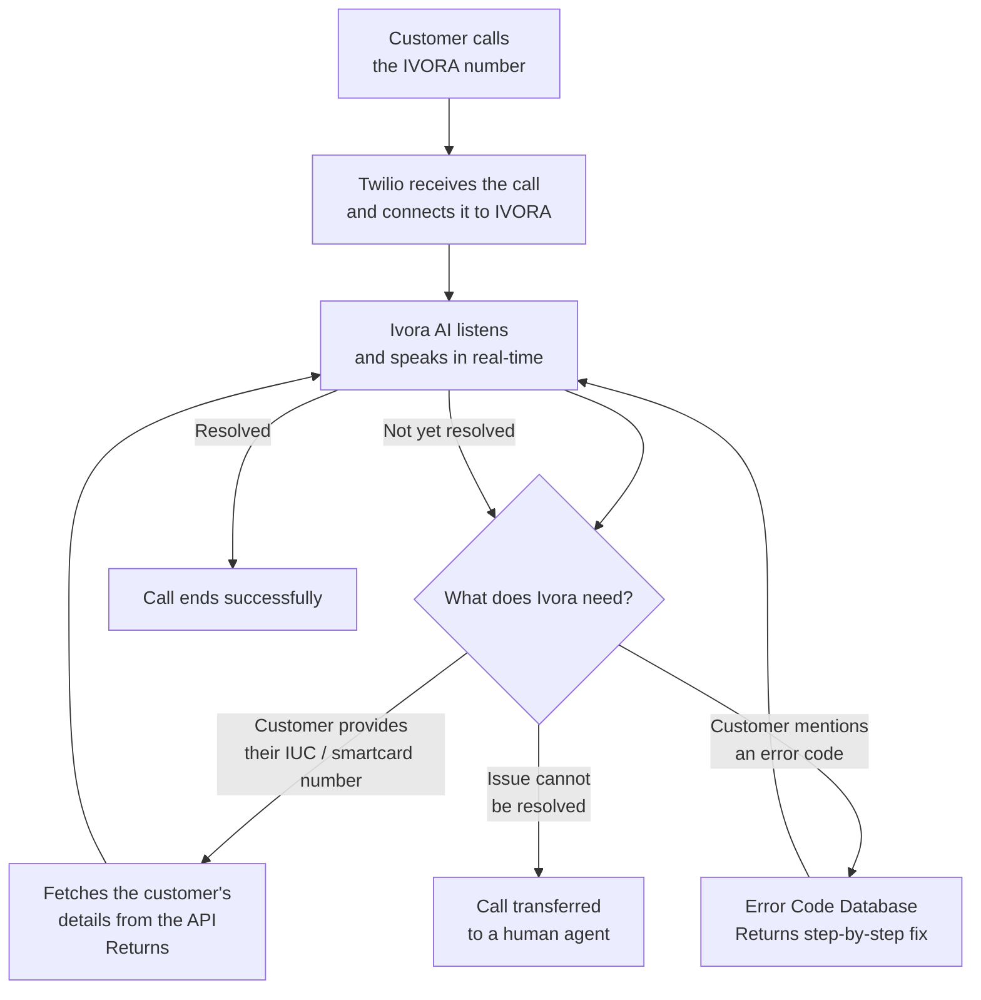

# IVORA — How It Works

A simplified overview of the full call flow, from the moment a customer calls to the moment their issue is resolved.

---

## System Flow Diagram

---

## How It Works

**1. The customer calls**
The customer dials a phone number assigned to IVORA. From their end, it feels like calling any support line.

**2. The call is connected**
Twilio — a phone infrastructure service — picks up the call and instantly connects it to the IVORA system. The customer's voice is streamed live to Ivora AI as they speak, with no delays.

**3. Ivora listens and responds**
Ivora AI understands what the customer is saying and responds naturally. If the customer gives their **IUC or Smartcard number**, Ivora quietly checks it against the  database and greets them by name. If they mention an **error code**, Ivora looks it up and walks them through the fix step by step.

**4. If Ivora can't help**
If the issue is too complex, or the customer asks to speak with a person, the call is transferred to a human support agent.

**5. Everything is logged**
Every call, conversation, and outcome is saved to a database so the support team can review trends and improve the service over time.

---

## Quick Reference

| What the Customer Experiences | What Is Happening |
| :--- | :--- |
| Calls a number and hears Ivora | Twilio connects the call to Ivora AI |
| Gives their IUC number | API returns their name |
| Ivora walks them through a fix | Error Code Database is searched |
| Gets transferred to a human | Twilio redirects the call to an agent |
| Hangs up after the issue is resolved | Call transcript is saved to the database |
